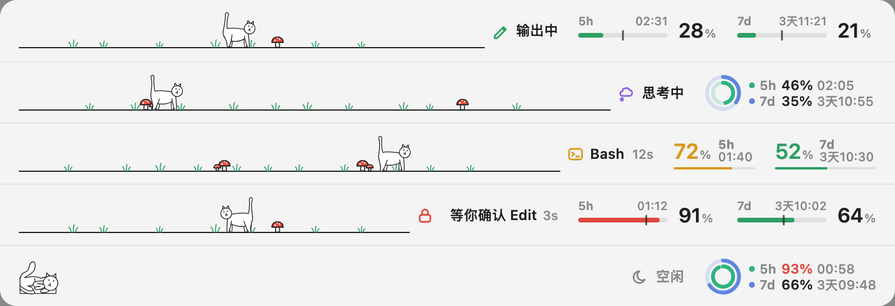

# petline

English | [中文](README.zh-CN.md)

A little pet for Claude Code, living in the band above the prompt. It walks while Claude works, faster as Claude
writes faster, and curls up when the session is idle. Beside it: what Claude is doing, and your 5-hour and 7-day
usage.

## Screenshots

<picture>
  <source media="(prefers-color-scheme: dark)" srcset="docs/images/states-dark.png">
  
</picture>

The usage takes turns in its three looks above (gauge, rings, large type); `/usage-style` picks one.

## Features

- **A pet that follows Claude**: it walks across the free room of the band while Claude thinks, writes, runs tools or
  waits for you, picking up speed in four steps as the output streams faster; when the session goes idle it runs
  home and lies down. No blinking, no jumps.
- **What Claude is doing**, at a glance: an icon and a few words for writing, thinking, the running tool and its time,
  or waiting for your approval.
- **Your usage**: the 5-hour and 7-day windows, green, yellow or red by how much is used, with the time until each
  resets; hover a window for its exact reset time. Kept in step across your sessions.
- Follows the app's light or dark appearance. Everything runs locally: no network calls.

## Install

In a Claude Code session:

```
/plugin marketplace add mrsxl/petline
/plugin install petline@petline
```

Pick the user scope. It shows in the Desktop app's Code tab and in the VS Code extension; the terminal keeps its own
status line. The usage needs a Claude subscription and appears after the first reply.

## Commands

| Command | What it does |
| --- | --- |
| `/usage-style` | Switch the usage look in every session: alone it moves to the next, `/usage-style 2` picks one |

## Good to know

- A plugin that answers permission requests before this one (a security plugin, say) keeps it from showing
  "waiting for your approval".
- The pet is a line cat for now. It is drawn from Lottie animations, so another animal can take its place.

## Develop

```bash
claude plugin validate .
claude plugin test .
```

- To have every session pick up each save, set `CLAUDE_CODE_PLUGIN_DIRS` to this folder and
  `CLAUDE_CODE_PLUGIN_DIR_WATCH` to `1` in the `env` of `~/.claude/settings.json` (and disable any installed copy).
- The pet's animations, `hooks/scenes.ts`, are built from `assets/lottie/` with `tools/export.html` and
  `tools/lottie_svg.py`; the screenshots above with `tools/readme-shots.ts`. Each tool says how to run it at its top.

## License

The code is under the MIT License, see [LICENSE](LICENSE). The pet's animations are by
[Stefan Lamprecht](https://lottiefiles.com/free-animation/cat-walking-7Fw16fjIY8) on LottieFiles: they, and the
drawings rebuilt from them (`assets/lottie/`, `hooks/scenes.ts`), are under the Lottie Simple License instead, see
[assets/lottie/LICENSE.md](assets/lottie/LICENSE.md).
