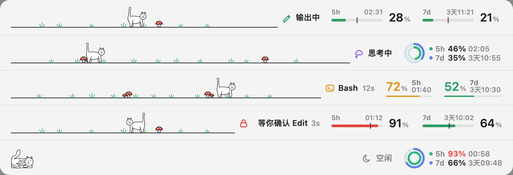

# petline

[English](README.md) | 中文

住在 Claude Code 输入框上方条带里的一只小宠物：Claude 干活时它就走起来，输出越快走得越快；会话空闲时它就躺下休息。旁边显示 Claude 正在做什么，以及你的 5 小时和 7 天用量。

## 效果图

<picture>
  <source media="(prefers-color-scheme: dark)" srcset="docs/images/states-dark.png">
  
</picture>

上图里用量轮流展示了三种样式：双行仪表、同心双环、大字排版，用 `/usage-style` 切换。

## 功能

- **跟着 Claude 动的小宠物**：Claude 思考、输出、运行工具或等你确认时，它在条带的空白处来回走，输出越快走得越快（分四档）；会话空闲时它跑回家躺下。全程不闪烁、不瞬移。
- **一眼看清 Claude 在做什么**：图标加几个字，显示输出中、思考中、正在运行的工具及时长，或者等你确认。
- **你的用量**：5 小时和 7 天两个窗口，按用量显示绿、黄、红三色，附带距离重置的时间；鼠标悬停可看具体重置时刻。多个会话之间自动同步。
- 自动跟随 app 的浅色/深色外观。全部在本地运行，不发任何网络请求。

## 安装

在 Claude Code 会话里运行：

```
/plugin marketplace add mrsxl/petline
/plugin install petline@petline
```

安装范围选 user。它显示在 Desktop app 的 Code 标签页和 VS Code 扩展里，终端里不显示（终端有自己的状态栏）。用量需要 Claude 订阅，在会话的第一次回复之后出现。

## 命令

| 命令 | 作用 |
| --- | --- |
| `/usage-style` | 切换所有会话的用量样式：不带参数换下一个，`/usage-style 2` 直接选第 2 个 |

## 须知

- 如果另一个插件先处理了权限请求（比如安全类插件），「等你确认」状态就不会出现。
- 小宠物目前是一只线条小猫。它是用 Lottie 动画生成的，以后可以换成别的小动物。

## 开发

```bash
claude plugin validate .
claude plugin test .
```

- 想让每个会话在保存后自动加载最新代码：在 `~/.claude/settings.json` 的 `env` 里把 `CLAUDE_CODE_PLUGIN_DIRS` 设为本文件夹、`CLAUDE_CODE_PLUGIN_DIR_WATCH` 设为 `1`（并停用已安装的版本）。
- 小宠物的动画 `hooks/scenes.ts` 由 `assets/lottie/` 经 `tools/export.html` 和 `tools/lottie_svg.py` 生成；上面的效果图由 `tools/readme-shots.ts` 生成。每个工具的用法写在文件开头。

## 许可证

代码按 MIT 许可证授权，见 [LICENSE](LICENSE)。小宠物的动画作者是 LottieFiles 上的 [Stefan Lamprecht](https://lottiefiles.com/free-animation/cat-walking-7Fw16fjIY8)；这些动画以及由它们生成的图形（`assets/lottie/`、`hooks/scenes.ts`）不适用 MIT，而是按 Lottie Simple License 授权，见 [assets/lottie/LICENSE.md](assets/lottie/LICENSE.md)。
